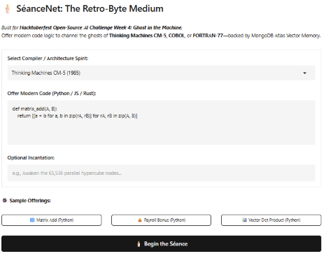
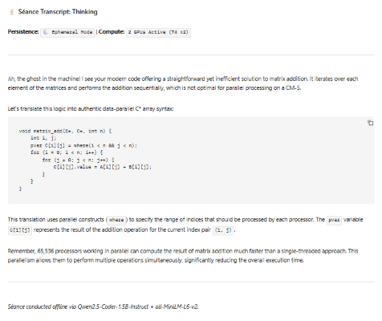

# SéanceNet: Ghost in the Machine Agent

**SéanceNet** is an open-source, local-first interactive code transmutation terminal built for the **Hacktoberfest Open-Source AI Challenge Week 4: Ghost in the Machine**.

It allows developers to offer modern Python, JavaScript, or Rust code to channel vintage supercomputer and mainframe personas (such as Thinking Machines CM-5 from 1985, COBOL mainframes, and FORTRAN-77 punch-card systems). Backed by MongoDB Atlas Vector Search for ancestral code memory retrieval and powered locally by `Qwen/Qwen2.5-Coder-1.5B-Instruct` and `all-MiniLM-L6-v2`.

---

## Demo & Output

### Modern Code Offering Interface

### Spectral Transmutation Transcript

---

## Key Features
- **Vintage Architecture Compilers:** Translates modern code into authentic data-parallel C* (65,536-node Connection Machine hypercube), COBOL enterprise divisions, or IBM FORTRAN-77.
- **MongoDB Atlas Vector Search:** Performs semantic vector retrieval across stored ancestral offerings to recall previous code transmutations.
- **Privacy-First & Open Weights:** Operates locally via `Qwen/Qwen2.5-Coder-1.5B-Instruct` and `all-MiniLM-L6-v2` with zero external cloud LLM API dependencies.
- **Graceful Ephemeral Fallback:** Seamlessly operates offline in ephemeral mode if database connections are absent or restricted.
- **Monochrome Retro UI:** Custom dark terminal aesthetic built using Gradio (`gr.themes.Monochrome()`).

---

## Tech Stack
- **Language:** Python 3.10+ (`main.py`)
- **Models:** `all-MiniLM-L6-v2` (Embeddings) & `Qwen/Qwen2.5-Coder-1.5B-Instruct` (LLM)
- **Database / Vector Search:** MongoDB Atlas (`pymongo`)
- **Frameworks:** PyTorch, Hugging Face `transformers`, `sentence-transformers`
- **Frontend/UI:** Gradio (`gr.Blocks`)

---

## License
This project is open-source under the MIT License. Built for the Hacktoberfest Open-Source AI Challenge.
